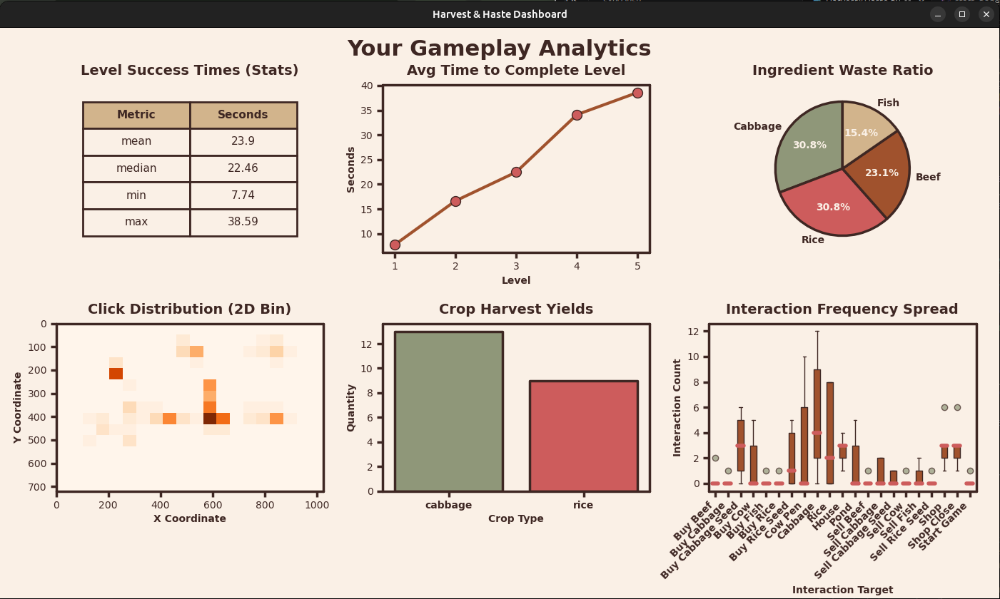
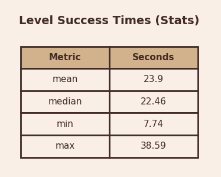
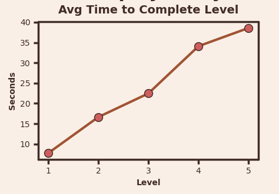
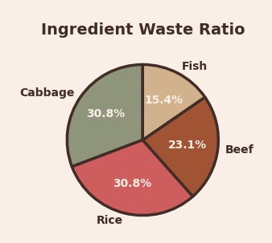
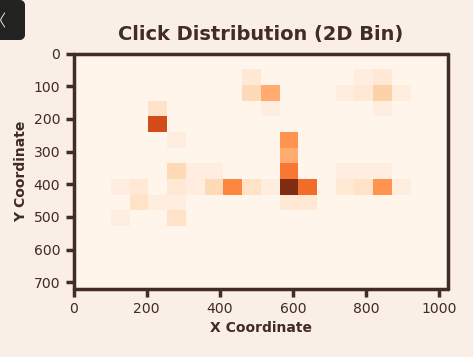
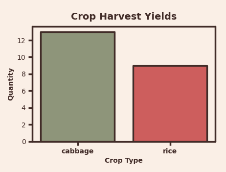
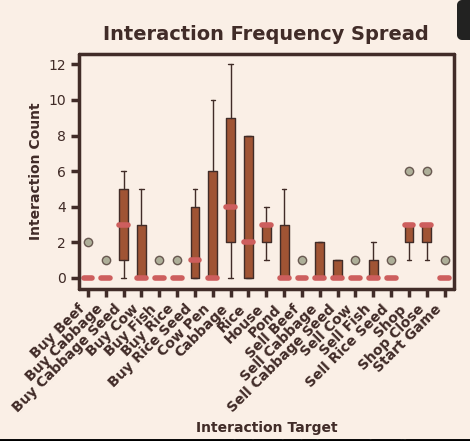

# Data Visualization

This document walks through the analytics dashboard of Harvest & Haste. The dashboard pops up automatically in a Tkinter window when you close the game, and it's basically a little report card of your session. Six charts are laid out in a single 2×3 grid titled **"Your Gameplay Analytics"**, all pulled from the data the `DataTracker` class quietly logged while you were playing.

---

## Overall Dashboard

The dashboard is a single page with six components arranged in a 2-row × 3-column grid. Top row: a Level Success Times table, an Average Time to Complete Level line graph, and an Ingredient Waste Ratio pie chart. Bottom row: a Click Distribution 2D histogram, a Crop Harvest Yields bar chart, and an Interaction Frequency Spread box plot. The whole thing uses a cozy cream-and-terracotta palette — cream background, brown text, artichoke green, sienna, and tan accents — so it feels like it belongs to the same game world rather than a boring spreadsheet. A single **Close & Exit** button at the bottom shuts everything down. All six charts are built from `current_session_stats.csv` using Pandas to crunch the numbers and Matplotlib to draw them.

---

## 1. Level Success Times (Stats Table)

This one's a simple stats table: two columns (**Metric** and **Seconds**) and four rows showing the mean, median, min, and max of your successful completion times, rounded to two decimal places. It's built from every `Level_Result` event where `Value2` was `"SUCCESS"`, with the completion time stored in `Value1`. The real thing to watch here is the gap between mean and median — if the mean is way higher than the median, it means one or two painfully slow runs dragged your average up. If they're close together, you played consistently. If you didn't beat any level this session, the panel just says "No Success Data" and shrugs.

---

## 2. Average Time to Complete Level (Line Graph)

This line graph shows your average successful completion time per level on the y-axis against the level number (1–5) on the x-axis, with a round marker at each data point. It's grouped with Pandas `.groupby("Level")` and then averaged. What you want to see is a rising line — each level *should* be harder than the last, so completion times *should* go up. If the line dips somewhere, that level turned out to be easier than expected for you, and if it spikes weirdly, that's the level that genuinely tripped you up. Levels you never won simply don't appear.

---

## 3. Ingredient Waste Ratio (Pie Chart)

This pie chart shows which ingredients you wasted most. Data comes from `Waste_Event` entries, filtered to the four valid ingredients (cabbage, beef, fish, rice). Each slice uses the same color as the ingredient in the harvest bar chart — artichoke green for cabbage, sienna brown for beef, tan for fish, terracotta for rice — so you can match them up across panels. Percentages are drawn right on the slices. This one's really useful for spotting your weakness: if beef is dominating the pie, you're burning steaks on the grill; if it's cabbage, you're over-chopping on the cutting board. If you made it through without wasting a thing, the panel just says "No Waste Recorded."

---

## 4. Click Distribution (2D Histogram)

This is a 2D histogram (20×15 bins) laid out over the 1024×720 kitchen screen, colored with the `Oranges` colormap. Every `Click_Position` event from a cooking minigame turns into a point in the histogram. The y-axis is flipped so the plot orientation matches how you actually see the game. Bright cells are where you clicked the most — usually right around the cutting board, pot, and pan. It's a great way to see whether your clicks were concentrated on the right spots or scattered all over the place hunting for the right target.

---

## 5. Crop Harvest Yields (Bar Chart)

A simple bar chart counting how many times you harvested each item type (rice, cabbage, fish, beef — whichever you actually harvested). Bars use the same color map as the pie chart for consistency. Data comes from every `Harvest` event, grouped by the item name. This chart basically shows your farming strategy at a glance — if one bar dwarfs the others, you leaned hard on that ingredient, while roughly even bars mean you spread your efforts across all the income sources.

---

## 6. Interaction Frequency Spread (Box Plot)

This box plot shows how often you interacted with each overworld target (fields, pond, cow pen, shop) across all the levels you played. `Interaction` events are pivoted by `Level` and `Item` using Pandas, so each box represents one target's level-by-level interaction counts. The box shows the interquartile range, the line inside is the median, the whiskers stretch to min/max, and any circles outside the whiskers are outlier levels. A tight high box for "Field Rice" means you farmed rice reliably every level; a wide box with dots floating off the top means you went all-in on that entity some levels and ignored it others. If there isn't enough variety yet, the panel just says "No Data."